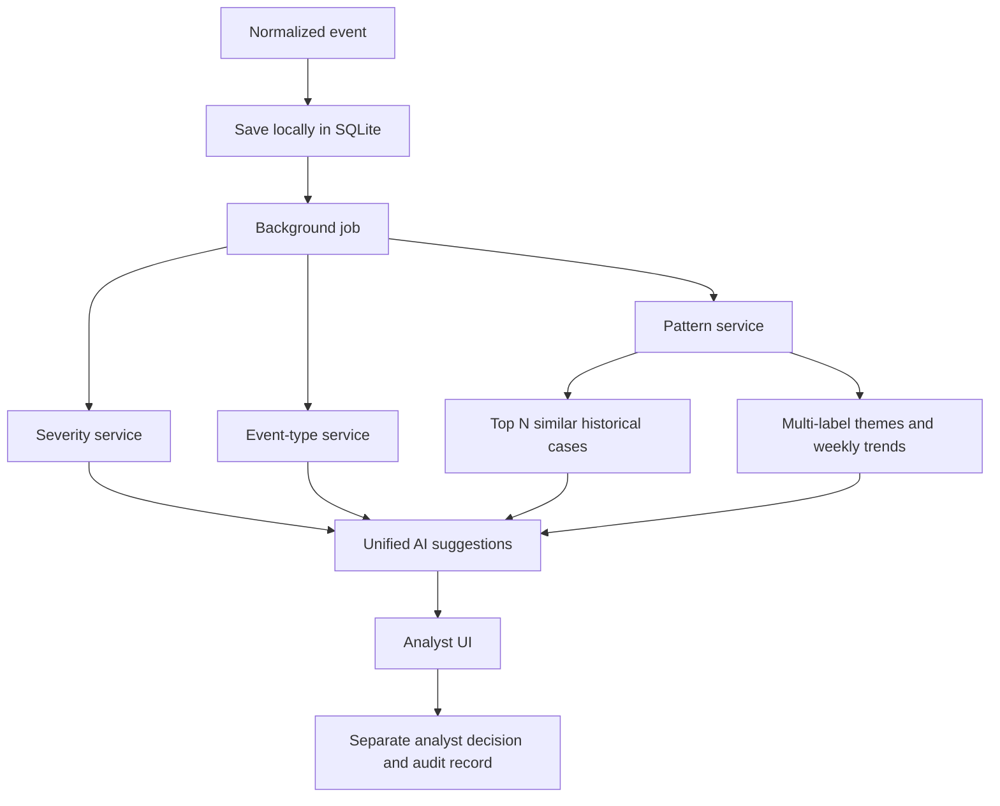

# MIDAS integration and analyst MVP

This is a local capstone prototype, not an approved clinical deployment. No report
text is sent to cloud AI. The demo contains **38 newly authored synthetic reports**;
it does not import the user's local MIDAS dataset. No existing training pipeline or
published model evaluation was modified.

## Run the app

From this repository:

```bash
python3 -m venv .venv
source .venv/bin/activate
python -m pip install -r requirements.txt
cd frontend
npm ci
npm run build
cd ..

# One time only, on an EMPTY dedicated demo database:
MIDAS_DATABASE=local_state/demo.sqlite3 python -m backend.seed --fixture-mode

# Local browser demo; fixed synthetic severity/type outputs are clearly labeled:
MIDAS_DATABASE=local_state/demo.sqlite3 MIDAS_FIXTURE_MODE=true ./run_app.sh
```

Open **http://127.0.0.1:8000/dashboard**, not frontend/index.html. All assets are
served locally. `run_app.sh` binds loopback, sets offline model flags, disables
access logs, and uses a restrictive umask. Stop with Ctrl-C. Use one server worker.
The seed command refuses to overwrite or mix fixtures into an existing database.
The existing `local_state/demo.sqlite3` created during verification can be reused;
do not seed it again.

MiniLM must already be cached. This workstation's cached model was verified. If
setting up a new workstation, download the model separately on an approved machine
or provision its cache; loading and inference in this app are offline-only. Model
downloads contain no report data. `MIDAS_EMBEDDING_BACKEND=lexical` is an explicit
384-dimensional hashing **smoke-test backend**, not semantic MiniLM and not suitable
for judging retrieval quality. The original CLI still provides its TF-IDF fallback
through `./run_local.sh --force-tfidf`; it was not replaced.

For frontend development run the API and `cd frontend && npm run dev`; Vite proxies
API requests locally. Build before serving the same-origin version above.

## Architecture



Severity never receives event-type probabilities. The auxiliary event-type hurt
head is discarded, not used for triage. Saving an event precedes analysis; failed
services return unavailable results while other services continue. The queue is
behind `JobQueue`; the vector index is behind `VectorStore`; deterministic naming
is behind `ThemeNamer`; audit persistence implements `AuditSink`.

SQLite tables: events, ai_results, event_embeddings, similar_events, themes,
event_themes, trend_results, analyst_feedback, audit_log. Payloads are versioned
JSON records; event and membership relationships have foreign keys. Theme rebuilds
replace the theme/membership/trend snapshot in one transaction. Stored embeddings
reload on restart; event data is immutable in this MVP. AI re-analysis replaces the
latest suggestion, but analyst decisions and audit entries are append-only.

## Model integration / missing artifacts

Inspected upstream snapshots:

| Repository | Commit | Used files |
|---|---|---|
| 3-bucket-grader | b147d62c89323c21915907a4ea7df4b4facd9553 | data_pipeline.py, severity_model.py |
| 11-buckets | 2b7d2743c5996d977fe627e7296280ca707fe9b7 | src/pipeline.py, src/mtl.py, baseline save configuration |

### Severity

Obtain the **trusted original** `vectorizer.joblib`, `model.joblib`,
`calibrator.joblib`, and matching `config.json` from the model owner. Joblib/pickle
can execute code; never load untrusted uploaded weights. Use the training Python /
scikit-learn environment for real artifacts (upstream documents Python 3.11).

The backend's `SeverityService.load_model(repo, artifacts)` loads once at startup.
`predict_event` / `predict_batch` call the original text builder, bucket summation,
and raw E–I mass function. Classifier class ordering/subsets are respected. Priority
uses `raw_triage >= config.cutoff_raw_triage`; **not** a 0.5 rule and **not** the
calibrated probability. Calibration uses the saved calibrator's positive class.
Versions fingerprint the artifacts and upstream source.

`integrations/severity_inference.py` is also a standalone drop-in `inference.py`
for the severity repository. It was added to the inspected local checkout, and a
durable copy is included here; no upstream GitHub changes were pushed. Copy it next
to severity_model.py to expose:

```python
from inference import load_model, predict_event, predict_batch
model = load_model('/trusted/local/severity_model')  # once at startup
# raw_intake must contain exactly the upstream intake columns, not label/review fields
result = predict_event(model, raw_intake)
```

### Event type

Obtain `outputs/baseline/model_seed0.pt` and its matching `train_log_seed0.json`.
The adapter uses the upstream `EmbeddingMultiTask` with its saved hidden size,
dropout and use_event_probs setting. State loading is strict and weights-only;
inference uses eval mode and CPU. Training used **unnormalized** MiniLM embeddings,
so the adapter must not reuse cosine-normalized pattern vectors. Output order is
ADR, C, E, EQ, FALL, I, ME, O, SH, SI, T. Only Head A is returned.

The fine-tuned BioClinicalBERT branch is not supported: upstream README says it has
not been trained. This MVP wraps the saved MiniLM baseline rather than inventing
new weights or silently changing architecture.

### Environment configuration

No API keys are required. Environment values are read at startup (restart after
changing them). `.env` is ignored by git but is **not auto-loaded**; export values
in your shell. Paths may be absolute or relative to the repo root.

| Variable | Default / purpose |
|---|---|
| MIDAS_DATABASE | local_state/midas.sqlite3; use a separate demo database |
| MIDAS_FIXTURE_MODE | false; true explicitly enables synthetic classifier fixtures |
| MIDAS_SEVERITY_REPO | this repo (the folder above analyst_app/) by default |
| MIDAS_SEVERITY_ARTIFACTS | its severity_model/ by default; run `python3 severity_model.py` there first |
| MIDAS_EVENT_TYPE_REPO | local 11-buckets checkout path |
| MIDAS_EVENT_TYPE_ARTIFACTS | its trusted outputs/baseline directory |
| MIDAS_EMBEDDING_BACKEND | minilm; lexical only for smoke tests |
| MIDAS_TOP_N | 5; stored similar-case count, 1–10000 |
| MIDAS_MEMBERSHIP_THRESHOLD | 0.80; per-theme cosine threshold, needs reviewer validation |
| MIDAS_CLUSTER_METHOD | hdbscan; agglomerative also supported |
| MIDAS_MINIMUM_CLUSTER_SIZE | 3; clusters below this support are excluded |
| MIDAS_CLUSTER_DISTANCE | 0.40; agglomerative cosine distance threshold |
| MIDAS_MINIMUM_EVENT_COUNT | 3; minimum current-week support |
| MIDAS_MINIMUM_PERCENT_INCREASE | 50; increase vs weekly baseline |
| MIDAS_Z_SCORE_THRESHOLD | 2 |
| MIDAS_BASELINE_WEEKS | 8 |
| MIDAS_MAX_PATTERN_EVENTS | 10000; local clustering resource guard |

Real-model example, after obtaining weights (do not point at the demo database):

```bash
export MIDAS_SEVERITY_REPO=/absolute/path/3-bucket-grader
export MIDAS_SEVERITY_ARTIFACTS="$MIDAS_SEVERITY_REPO/severity_model"
export MIDAS_EVENT_TYPE_REPO=/absolute/path/11-buckets
export MIDAS_EVENT_TYPE_ARTIFACTS="$MIDAS_EVENT_TYPE_REPO/outputs/baseline"
export MIDAS_FIXTURE_MODE=false
./run_app.sh
```

## Input and pattern methodology

The frontend only sends `EventInput`, never raw MIDAS column names. It forbids extra
fields. Exact adapters create these submission-time fields only: event_comments,
Location Name, Encounter Service, Age at Encounter, the prescribed/administered
medication and dose fields, and ADR suspect medication/dose fields.

One documented normalized text representation is used:
`Unit: ... . Service: ... . Age: ... . Prescribed: ... . Administered: ... . ADR suspect medication: ... .`
followed by a newline and the narrative. Missing prefix parts are omitted; integral
ages are formatted as integers. Automated upstream parity tests verify exact
spacing/formatting. The upstream builders are also called directly by both model
adapters. Report ID, date, facility, event-type labels, PSRS and all human-review
targets never enter this text. Metadata can still influence embeddings through
unit/service; this should be assessed in reviewer evaluation.

Patterns use real local MiniLM normalized 384-dimensional vectors. Exact cosine
retrieval ranks only reports with event_date **strictly earlier** than the query
report, excludes self and caps N at available cases (API resource limit 10000).
Because only a date is supplied, same-day events are excluded conservatively.
Free-text search spans all stored reports and makes no historical-order claim.
Similarity scores are not probabilities. The existing CLI novelty workflow stays
available separately; novelty is not presented as a severity signal in the UI.

HDBSCAN discovers an unknown number of clusters and allows noise. If unavailable,
agglomerative average-linkage cosine clustering is used. Noise is not forcibly
assigned. A report independently joins every theme whose centroid similarity
exceeds the configured threshold. Themes can overlap and their counts must not
be added to obtain unique event counts. Names use deterministic TF-IDF keywords;
no LLM is needed. New events join existing themes on analysis; explicit rebuilds
discover new themes and recompute centroids. IDs are stable for identical rebuilds
but may change if cluster composition changes (not a longitudinal identity model).

Trends compare the **last complete Monday–Sunday week**, not a partial week, to
the prior N complete weeks. Missing weeks count as zero. Score:
`(current - baseline_mean) / max(baseline_std, sqrt(baseline_mean), 1)`.
Emerging requires support + percent increase + score threshold; watch requires
support + increase; otherwise stable. If baseline is zero, `percent_change=null`
is intentional, UI says "New from zero", and support/score still apply. These are
reporting-count associations, not causal conclusions or exposure-adjusted rates.

## API and UI

OpenAPI: http://127.0.0.1:8000/openapi.json is the fully local machine-readable
contract. CDN-backed Swagger/ReDoc pages are disabled. The analyst UI has no
external assets, fonts or analytics.

Required routes implemented: POST/GET events; GET event detail; POST ai/analyze;
GET event AI; GET event similar; GET patterns, pattern detail, pattern events;
GET trends and trend detail; POST patterns/rebuild. Additional routes:
POST search, POST events/{opaque-id}/feedback, GET dashboard, GET health.

All URL identifiers are opaque internal UUIDs or theme IDs—not source report IDs.
Search narratives are POST bodies. Events and associated cases are paginated.
Rebuild/analysis returns 202; health includes rebuild status and sanitized startup
errors. The UI has dashboard, worklist, event detail, trends, trend detail and
similar-case search. Refresh after background work. AI/analyst decisions remain
visually and persistently separate. This is an unauthenticated local analyst role,
not verified individual attribution.

## Validation and files

```bash
./run_tests.sh
# Also exercise exact upstream source contracts, using your local checkouts:
MIDAS_TEST_SEVERITY_REPO=/path/3-bucket-grader \
MIDAS_TEST_EVENT_TYPE_REPO=/path/11-buckets ./run_tests.sh
cd frontend
npm run typecheck
npm run build
```

See `MVP_VERIFICATION.md` for observed results and commands. Optional upstream tests
skip if checkout paths are not configured. Tests use only authored synthetic data;
the temporary zero-weight event-type checkpoint checks interface loading, not
accuracy. No trained model quality is claimed from fixtures.

New files: backend/{app,config,contracts,inference,patterns,services,storage,seed}.py,
backend/__init__.py, integrations/severity_inference.py, frontend/ (React app, CSS,
types, Vite/TypeScript config, package manifests and lock), run_app.sh, PLAN.md,
this guide, MVP_VERIFICATION.md and tests/test_integration.py. Modified README,
requirements, ignore rules and test runner. Existing pattern/CLI source unchanged.

Generated local files: local_state/demo.sqlite3 (and SQLite WAL/SHM when open),
frontend/dist/index.html and bundled assets, node_modules and virtual-environment
packages. All are ignored. No input report datasets or generated outputs uploaded.

## Remaining blockers and deployment limits

- Missing original severity and event-type weights prevent real classifier
  inference validation. Ask teammates for the artifacts above and their dependency
  versions; do not retrain simply to make the UI run.
- No MIDAS connector/access contract has been provided. This MVP offers normalized
  API submission; raw source CSV ingestion and sponsor-system authentication remain
  separate integration work. The local candidate dataset was not loaded for this UI.
- No hospital SSO/RBAC, encryption-at-rest service, retention policy, authenticated
  audit actor, durable job queue/retries, migrations or full AI prediction history.
  Do not expose this server to a network or use with live patient data until those
  controls and institutional approvals are in place. File permissions are not a
  substitute for encryption. No compliance certification is claimed.
- Exact retrieval, SQLite JSON reads and clustering are small-workspace MVP choices,
  not validated at 80k reports. HDBSCAN/agglomerative rebuilds can be expensive; the
  resource guard rejects oversized rebuilds rather than silently sampling data.
- MiniLM truncates long input to its model token limit. Prefix metadata can consume
  that budget. Theme thresholds/names, overlap, timeline identity and alert quality
  need safety-reviewer evaluation. Seed reports repeat three narratives only, so
  their high similarities and clean clusters are not evidence of real-world accuracy.
- BackgroundTasks are in-process and not durable across a crash. Pending jobs can
  be resubmitted using analyze. A disk write failure can leave a job pending; the
  original stored report is retained. Weekly snapshots refresh on analysis/rebuild,
  not automatically on a new calendar week.
- The existing Python 3.9 system environment emits a LibreSSL/urllib3 compatibility
  warning. Offline tests pass; use a supported Python 3.11+ environment matching
  the teammates' artifacts for real-model integration.
